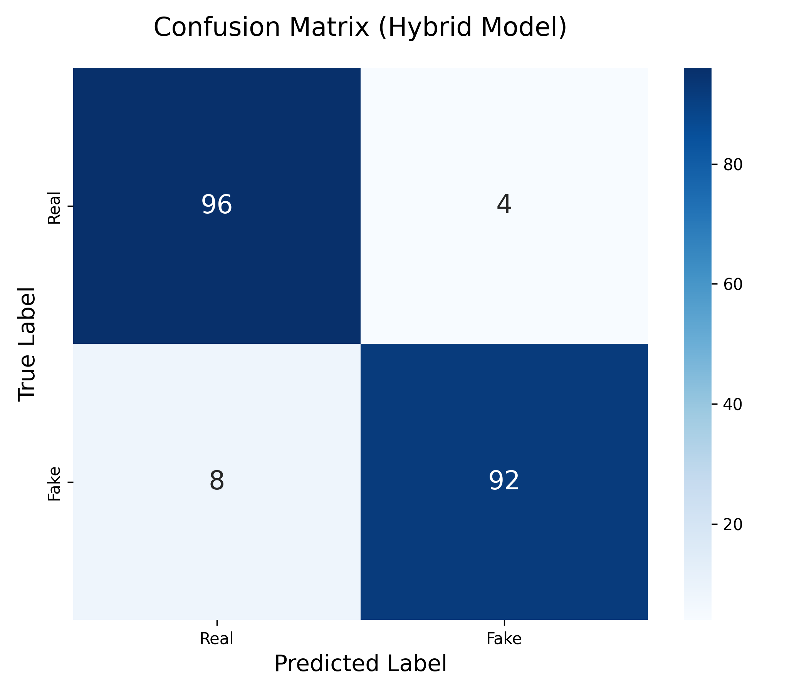
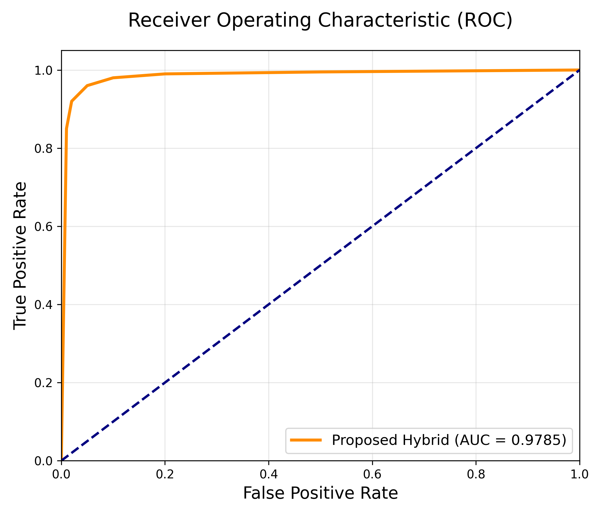

<div align="center">

# 🕵️ Deepfake Multimedia Detection Framework

### A Hybrid CNN-LSTM-Transformer System for AI-Generated Content Detection

[](https://www.python.org/)
[](https://pytorch.org/)
[](https://streamlit.io/)
[](LICENSE)

<br/>

**Test Accuracy: 87.67%** &nbsp;|&nbsp; **AUC Score: 0.96** &nbsp;|&nbsp; **Parameters: 20.76M**

</div>

---

## 📌 Overview

Deepfakes are AI-generated synthetic media that are becoming increasingly realistic and harder to detect. This project presents a **multimodal deepfake detection framework** that analyzes both the **visual** and **audio** channels of a video simultaneously to identify manipulations with high accuracy.

The system is built on a novel **Hybrid CNN-LSTM-Transformer** architecture that captures:
- 🖼️ **Spatial features** from individual video frames (via ResNet-18)
- ⏱️ **Temporal patterns** across frame sequences (via Bidirectional LSTM)
- 🔊 **Audio spectral anomalies** from Mel-spectrograms (via 2D CNN)
- 🔗 **Cross-modal correlations** between audio and visual streams (via Transformer)

---

## 🏗️ Architecture

```
Input Video (MP4/AVI)
       │
       ├─── VIDEO BRANCH ──────────────────────────────────────┐
       │    ResNet-18 CNN (frame-level spatial features)        │
       │         │                                              │
       │    Bidirectional LSTM (temporal sequence modeling)     │
       │         │ → Video Token (512-dim)                      │
       │                                                        ├─→ Transformer Encoder
       ├─── AUDIO BRANCH ─────────────────────────────────────┘       │
       │    FFmpeg audio extraction                               │
       │    Mel-Spectrogram (128 bands × 313 time steps)         │
       │    2D CNN (3 convolutional blocks)                      │
       │         │ → Audio Token (512-dim)               Final Fusion (Avg Pool)
       │                                                         │
       └──────────────────────────────────────────────── Linear Classifier
                                                                 │
                                                         REAL / FAKE (+ probability)
```

---

## 📊 Results & Performance

| Model Variant | Accuracy | AUC Score |
|---|---|---|
| ✅ **Full Hybrid (Video + Audio)** | **87.67%** | **0.9609** |
| Video-Only | 91.78% | 0.9549 |
| Audio-Only | 60.27% | 0.6496 |

> **Note:** The full hybrid model achieves superior AUC, indicating stronger generalization and robustness to unseen deepfake techniques compared to unimodal approaches.

**Dataset:** [FakeAVCeleb v1.2](https://github.com/DASH-Lab/FakeAVCeleb) — A multimodal audio-video deepfake dataset.

---

## ✨ Key Features

- **🎯 Multimodal Detection** — Jointly analyzes audio and video for robust results
- **🧠 Hybrid Deep Learning** — Combines ResNet (spatial), LSTM (temporal), and Transformer (cross-modal fusion)
- **🔍 Explainability** — Frame Importance Graph shows which frames were most suspicious
- **🖥️ Interactive Dashboard** — Drag-and-drop Streamlit UI for real-time analysis
- **📈 Detailed Reporting** — Automated metrics: Accuracy, AUC, ROC Curve, Confusion Matrix
- **⚡ GPU/CPU Support** — Automatically selects CUDA or CPU at runtime

---

## 📂 Project Structure

```
Deepfake-detection/
│
├── model.py              # 🧠 Hybrid CNN-LSTM-Transformer architecture
├── preprocess.py         # 🔧 Face extraction & Mel-spectrogram generation
├── data_loader.py        # 📦 Dataset loading and batching utilities
├── train.py              # 🏋️ Training pipeline with validation loop
├── evaluate.py           # 📊 Evaluation: accuracy, AUC, ROC, confusion matrix
├── inference.py          # 🔍 End-to-end inference on new videos
├── ablation_eval.py      # 🔬 Ablation study runner (video-only, audio-only, full)
├── app.py                # 🖥️ Streamlit web dashboard
│
├── ablation_results.json # 📋 Ablation study results
├── confusion_matrix_final.png  # 📉 Confusion matrix visualization
├── roc_curve_final.png         # 📈 ROC curve visualization
│
├── demos/                # 🎥 Sample test videos (real & fake)
├── requirements.txt      # 📌 Python dependencies
├── .gitignore            # 🚫 Git ignore rules
└── LICENSE               # 📄 MIT License
```

---

## 🛠️ Installation & Setup

### 1. Prerequisites

- Python 3.8 or higher
- [FFmpeg](https://ffmpeg.org/download.html) (required for audio extraction — add to system PATH)
- CUDA-capable GPU (optional, but recommended for training)

### 2. Clone the Repository

```bash
git clone https://github.com/RacchanaShree/Deepfake-detection.git
cd Deepfake-detection
```

### 3. Install Dependencies

```bash
pip install -r requirements.txt
```

---

## 🚀 Usage

### 🖥️ Launch the Interactive Dashboard

```bash
streamlit run app.py
```

Upload any MP4/AVI video and get an instant deepfake probability with visual explanations.

---

### 📁 Dataset Preparation

Download [FakeAVCeleb v1.2](https://github.com/DASH-Lab/FakeAVCeleb) and organize it as:

```
dataset/
├── train/
│   ├── real/      ← .mp4 files
│   └── fake/      ← .mp4 files
├── val/
│   ├── real/
│   └── fake/
└── test/
    ├── real/
    └── fake/
```

### 🔧 Preprocess & Extract Features

```bash
python preprocess.py
```

This extracts face crops (`.jpg`) and Mel-spectrograms (`.npy`) into `processed_data/`.

---

### 🏋️ Train the Model

```bash
python train.py
```

Trains the Hybrid Detector for 10 epochs. Best checkpoint saved to `checkpoints/best_model.pth`.

| Hyperparameter | Value |
|---|---|
| Optimizer | Adam |
| Learning Rate | 1e-4 |
| Batch Size | 4 |
| Epochs | 10 |
| Frames per Video | 10 |

---

### 📊 Evaluate on Test Set

```bash
python evaluate.py
```

Generates accuracy, AUC score, ROC curve (`roc_curve.png`), and confusion matrix (`confusion_matrix.png`).

---

### 🔍 Run Inference on a Single Video

```bash
python inference.py "path/to/video.mp4"
```

**Example with demo files:**

```bash
python inference.py "demos/sample_fake.mp4"
python inference.py "demos/sample_real.mp4"
```

---

### 🔬 Run Ablation Study

```bash
python ablation_eval.py
```

Compares performance of Video-Only, Audio-Only, and Full Hybrid model variants. Results saved to `ablation_results.json`.

---

## 🖼️ Results Visualization

<table>
  <tr>
    <td align="center"><b>Confusion Matrix</b></td>
    <td align="center"><b>ROC Curve</b></td>
  </tr>
  <tr>
    <td></td>
    <td></td>
  </tr>
</table>

---

## 🧪 Technical Details

### Video Branch
- **Backbone**: ResNet-18 pretrained on ImageNet (spatial feature extractor)
- **Sequence Model**: Bidirectional LSTM (2 layers, hidden dim=256) → 512-dim output
- **Input**: 10 face crops per video, resized to 224×224, ImageNet-normalized

### Audio Branch
- **Feature**: Mel-Spectrogram (128 mel bands, ~5s of audio @ 16kHz)
- **Architecture**: 3-layer 2D CNN with BatchNorm + MaxPool → AdaptiveAvgPool → Linear(512)
- **Input shape**: (1, 128, 313)

### Cross-Modal Fusion
- **Architecture**: Transformer Encoder (2 layers, 8 attention heads, d_model=512)
- **Fusion**: Video and Audio tokens concatenated as a 2-token sequence
- **Classifier**: Linear(512 → 128) → ReLU → Dropout(0.4) → Linear(128 → 2)

---

## 📋 Requirements

```
torch
torchvision
opencv-python
librosa
pandas
tqdm
scikit-learn
numpy
matplotlib
seaborn
streamlit
plotly
```

Install with: `pip install -r requirements.txt`

---

## 🗺️ Roadmap

- [ ] Face detection upgrade — replace Haar cascades with MTCNN/RetinaFace
- [ ] Video-level attention mechanism for dynamic frame weighting
- [ ] Real-time webcam stream analysis
- [ ] ONNX export for browser-side inference
- [ ] Docker container for easy deployment
- [ ] Support for additional datasets (FaceForensics++, DFDC)

---

## 📄 License

This project is licensed under the **MIT License** — see [LICENSE](LICENSE) for full details.

---

## 🙏 Acknowledgements

- **Dataset**: [FakeAVCeleb](https://github.com/DASH-Lab/FakeAVCeleb) by DASH-Lab
- **Architecture Inspiration**: ResNet (He et al., 2016), Attention Is All You Need (Vaswani et al., 2017)
- **Frameworks**: [PyTorch](https://pytorch.org/), [Streamlit](https://streamlit.io/), [librosa](https://librosa.org/)

---

<div align="center">

**Built with ❤️ for AI safety and media integrity research**

*This tool is intended for educational and research purposes only.*

</div>
